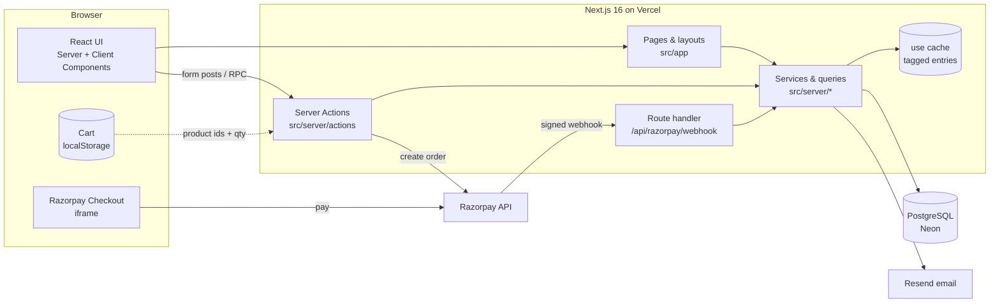

# Architecture

## System overview



One Next.js application does everything: storefront, admin, API. There are no separate backend
services — Server Actions are the backend. External dependencies are PostgreSQL, Razorpay and Resend.

## Folder structure

```
.
├── src/
│   ├── app/                    Routes only — pages, layouts, route handlers, metadata files
│   │   ├── (storefront)/       Customer pages sharing the navbar/footer layout
│   │   ├── (auth)/             Login, register, forgot/reset password (centred card layout)
│   │   ├── admin/              Admin area (own sidebar layout, ADMIN role required)
│   │   ├── api/                auth/[...nextauth], razorpay/webhook
│   │   ├── layout.tsx          Root: fonts, theme script, toaster
│   │   ├── globals.css         Design tokens (light/dark) + Tailwind
│   │   ├── sitemap.ts, robots.ts, not-found.tsx, global-error.tsx
│   ├── components/
│   │   ├── ui/                 Design-system primitives: button, input, select, badge…
│   │   ├── layout/             Navbar, footer, cart drawer, logo, theme toggle
│   │   ├── home/ catalog/ checkout/ orders/ auth/ forms/ admin/   Feature components
│   ├── config/                 Static config usable anywhere: site.ts, images.ts, india.ts
│   ├── lib/                    Pure shared code: utils, validators (zod), pricing (+ tests)
│   ├── server/                 Server-only code (each file imports "server-only")
│   │   ├── actions/            "use server" mutations: public, checkout, account, admin
│   │   ├── queries/            Cached reads ("use cache" + cacheTag): catalog
│   │   ├── services/           Business logic: orders (pricing, creation, markOrderPaid)
│   │   ├── payments/           Razorpay client + signature verification (+ tests)
│   │   ├── shipping/           Shiprocket API helpers (not wired yet)
│   │   ├── security/           Rate limiting
│   │   ├── auth.ts             Auth.js configuration
│   │   ├── session.ts          getSession / requireUser / requireAdmin / assertAdmin
│   │   ├── db.ts               Prisma client singleton
│   │   ├── email.ts            Resend templates + dev outbox
│   │   └── env.ts              Production env validation
│   ├── stores/                 Client state (Zustand cart)
│   ├── types/                  Global type augmentation (Auth.js session)
│   ├── test/                   Unit-test helpers
│   └── instrumentation.ts      Boot-time env check + structured error logging
├── prisma/                     schema.prisma, migrations/, seed.ts, data/catalog.ts
├── e2e/                        Playwright tests + helpers
├── scripts/                    One-off tooling (placeholder product art)
├── public/                     Static assets (logo, product art)
├── docs/                       This documentation + ADRs
└── .github/                    CI workflow, Dependabot, PR template
```

### Import rules

| Layer | May import | Must not import |
|---|---|---|
| `app/` | everything | — |
| `components/` (client) | `ui`, `lib`, `config`, `stores`, **server actions** | `server/*` other than `server/actions/*` |
| `components/` (server) | also `server/queries`, `server/session` | — |
| `server/` | `lib`, `config`, other `server/*` | `components/`, `app/`, `stores/` |
| `lib/`, `config/` | each other | anything React-specific or server-only |

`import "server-only"` at the top of every `server/` module turns an accidental client import into a
build error. Imports use the `@/` alias (`@/server/db`, `@/components/ui/button`).

## Rendering and caching model

The app runs with **Cache Components** (`cacheComponents: true`) and **Partial Prefetching**. Every
route is *partially prerendered*: a static shell is served instantly and dynamic parts stream in.

| Kind of data | How it's fetched | Example |
|---|---|---|
| Public catalogue | `"use cache"` functions with `cacheLife` + `cacheTag` | `getCatalog`, `getProductBySlug`, `getCategories` in `server/queries/catalog.ts` |
| Per-user data | Inside `<Suspense>`, after `await connection()` (via `getSession`) | account, checkout, admin pages, navbar account button |
| URL data (`params`, `searchParams`) | Read inside a `<Suspense>` child component, not at the page top level | product page, catalogue results, track page |
| Mutations | Server Actions | everything that writes |

**Cache invalidation** — writes refresh cached reads by tag:

| Event | Tags refreshed |
|---|---|
| Admin saves / archives a product | `products`, `categories`, `product:<slug>` (`updateTag`, read-your-own-writes) |
| Payment confirmed (stock changes) | `products` (`revalidateTag(…, "max")`, stale-while-revalidate) |
| Order cancelled/refunded (stock returned) | `products`, `categories` |
| Review submitted | `reviews`, `products` |

Checkout never trusts cached stock: `priceCart` reads live from the database.

## Key request flows

### Browsing a product
1. Static shell (header, footer, skeleton) is served from the CDN.
2. Inside `<Suspense>`, `ProductDetail` awaits `params` and calls `getProductBySlug(slug)` — a cached
   function, so repeat visits don't touch the database for minutes.
3. The account button streams separately (it reads the session cookie).

### Checking out
See [payments](payments.md) for the full sequence. In short: the client sends product IDs and
quantities → `startCheckout` re-prices from the DB, creates a `PENDING` order and a Razorpay order →
Razorpay Checkout collects payment → `confirmRazorpayPayment` verifies the signature →
`markOrderPaid` (transaction) → confirmation email.

### Admin changes an order
`updateOrderStatus` (server action) → `assertAdmin()` (role re-checked in DB) → transaction: return
stock if a paid order is cancelled, update status → upsert shipping info → optional customer email →
`revalidatePath` for the admin pages.

## Cross-cutting concerns

| Concern | Where |
|---|---|
| Authentication | `server/auth.ts` (Auth.js, JWT sessions), `server/session.ts` helpers |
| Authorisation | `requireUser`, `requireAdmin` (pages), `assertAdmin` (actions); every query is scoped by `userId` |
| Validation | zod schemas in `lib/validators.ts`, used by every action |
| Rate limiting | `server/security/rate-limit.ts` (Postgres-backed) |
| Errors | `error.tsx` per area, `global-error.tsx`, `onRequestError` structured logs in `instrumentation.ts` |
| Config validation | `server/env.ts`, run at boot by `instrumentation.ts` |
| Styling | Tailwind 4 with design tokens in `globals.css` (`bg-surface`, `text-muted-foreground`, …) |
