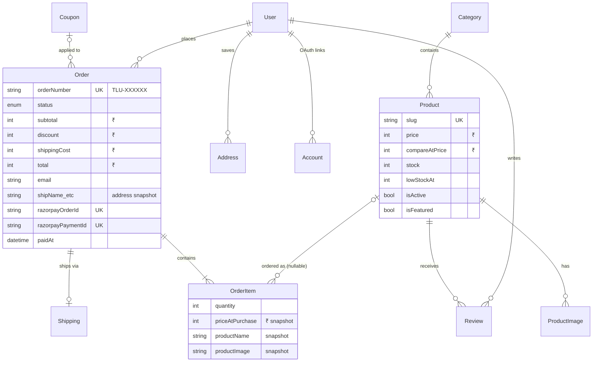
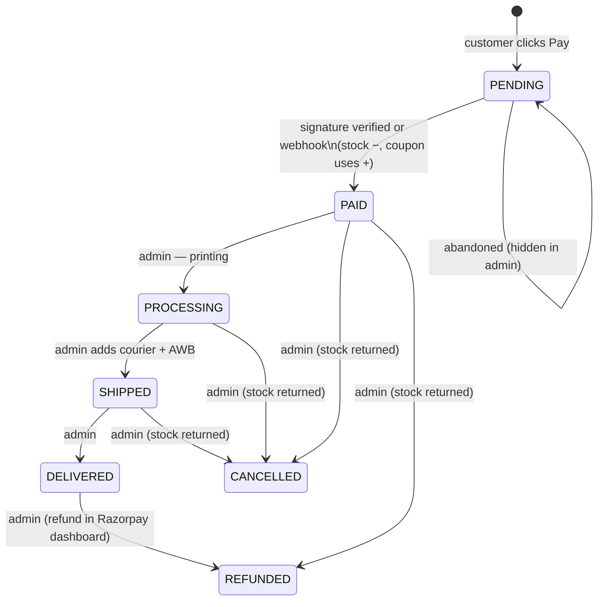

# Data model

Source of truth: [`prisma/schema.prisma`](../prisma/schema.prisma). Migrations live in
`prisma/migrations/` and are applied with `prisma migrate deploy`.

## Entity relationships



Also: `Session`, `VerificationToken` (Auth.js; reset tokens use identifier `reset:<email>` and store a
SHA-256 hash), `ContactMessage`, `CustomOrder`, `NewsletterSubscriber`, `RateLimit`, `WishlistItem`
(table exists, feature not built yet).

## Rules baked into the schema

1. **Money is `Int` in whole rupees** — `price`, `subtotal`, `total`, coupon `value`, etc. Converted to
   paise only at the Razorpay boundary with `toPaise()`, which rejects fractions.
   ([ADR-0004](adr/0004-money-as-integer-rupees.md))
2. **Orders are snapshots.** The shipping address is copied into `ship*` columns and each item stores
   `productName`, `productImage` and `priceAtPurchase`. Deleting a product sets `OrderItem.productId`
   to `NULL` instead of breaking history. ([ADR-0006](adr/0006-order-snapshots.md))
3. **Uniqueness guards correctness:** `orderNumber`, `razorpayOrderId` and `razorpayPaymentId` are
   unique, so a payment can never attach to two orders; one review per user per product.
4. **Products are archived, not deleted** (`isActive = false`) from the admin.

## Order lifecycle



- Only `PENDING → PAID` is automatic (`markOrderPaid`); it uses
  `updateMany({ where: { status: "PENDING" } })` as a compare-and-set so it runs exactly once.
- Refunds are issued from the **Razorpay dashboard**; the admin then marks the order `REFUNDED`
  (see [operations](operations.md#refunds)).
- Customers see only non-pending orders.

## Custom request lifecycle

`NEW → QUOTED → ACCEPTED → IN_PRODUCTION → COMPLETED` (or `REJECTED`). Quotes are recorded in the
admin; payment for custom work is currently arranged outside the store (see roadmap).

## Migrations

| Migration | What |
|---|---|
| `0001_init` | All core tables |
| `0002_rate_limit` | `RateLimit` table |

Writing a new one: change `schema.prisma`, then generate SQL without touching any database:

```bash
npx prisma migrate diff --from-migrations prisma/migrations \
  --to-schema-datamodel prisma/schema.prisma --script \
  --shadow-database-url "<a throwaway postgres URL>" > prisma/migrations/0003_name/migration.sql
# or, against a disposable local DB:
npx prisma migrate dev --name name
```

Never point a shadow-database URL at a real database — Prisma wipes it. Keep migrations
backwards-compatible with the running version (add columns as nullable / with defaults; remove in a
later release) because Vercel runs migrations before the new code is live.
