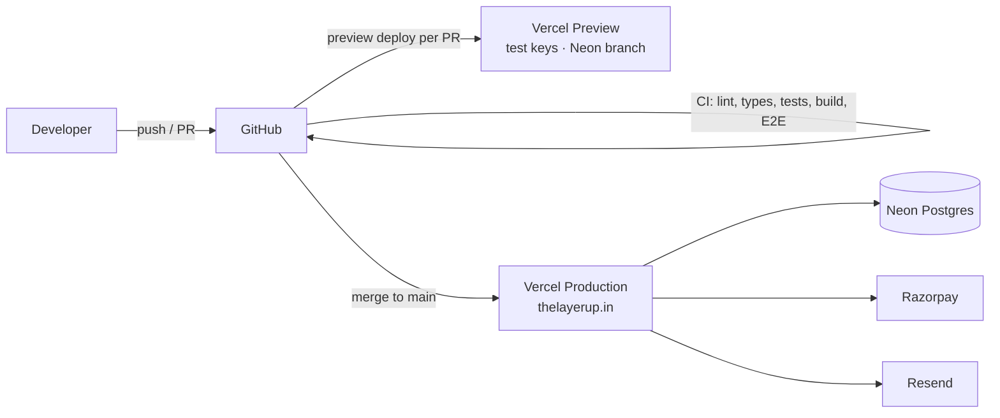

# Deployment

Target: **Vercel** (app) + **Neon** (Postgres, Singapore `ap-southeast-1`) + **Resend** (email) +
**Razorpay** (payments) on **https://thelayerup.in**.



## One-time setup

### 1. Database (Neon)
1. In Vercel → *Storage → Create Database → Neon*, region **Singapore** (`sin1`). Neon has no India
   region; Singapore is the closest. The app's functions must run in the same region (see step 3).
2. Connect it to the project. The integration sets `POSTGRES_PRISMA_URL` (pooled, for the app) and
   `DATABASE_URL_UNPOOLED` (direct, for migrations) — the two names the Prisma schema reads.
   Nothing to copy by hand.

### 2. Email (Resend)
1. Add domain `thelayerup.in`, add the SPF/DKIM DNS records it shows, wait for *Verified*.
2. Create an API key → `RESEND_API_KEY`. Set `EMAIL_FROM="TheLayerUp <orders@thelayerup.in>"`.

### 3. Vercel
1. Import the GitHub repo. Framework: Next.js. Build command: leave default — Vercel runs
   `vercel-build` (`prisma migrate deploy && next build`). Node.js version: 22.x.
2. Add env vars for **Production** (and Preview with test keys). Full list:
   [configuration](configuration.md). Include `CRON_SECRET` (`openssl rand -hex 32`) and
   `STORE_NOTIFY_EMAIL` — the boot log warns if either is missing.
   `vercel.json` already pins functions to **Singapore (`sin1`)**, next to the Neon database, and
   schedules the daily cleanup job — nothing to set in the dashboard for these.
3. *Domains*: add `thelayerup.in` and `www.thelayerup.in` (redirect www → apex). Update DNS at your
   registrar as Vercel instructs.

### 4. Razorpay
1. Dashboard → *Account & Settings → Webhooks → Add*:
   URL `https://thelayerup.in/api/razorpay/webhook`, events `payment.captured`, `order.paid`,
   create a secret → `RAZORPAY_WEBHOOK_SECRET`.
2. Do this separately in **Test** and **Live** mode (they have separate webhooks and secrets).

### 5. First deploy + seed
1. Deploy (push to `main` or *Redeploy*). Migrations run automatically.
2. Seed once from your machine against production:

   ```bash
   POSTGRES_PRISMA_URL="<pooled>" DATABASE_URL_UNPOOLED="<direct>" \
   SEED_ADMIN_EMAIL="you@thelayerup.in" SEED_ADMIN_PASSWORD="<12+ chars, unique>" \
   npm run db:seed
   ```

   This creates categories, the two coupons and your admin user. Sample products are skipped on
   non-local databases (`SEED_SAMPLE_PRODUCTS=true` to include them).
3. Sign in, add real products in `/admin/products`.
4. Check `https://thelayerup.in/api/health` returns `{"status":"ok"}`.
5. Run the [manual release checklist](testing.md#manual-release-checklist).

### 6. Razorpay KYC
Razorpay reviewers look for these pages on the live domain — all exist, but the text is a template
and must be reviewed and match how you actually operate:
`/policies/terms`, `/policies/privacy`, `/policies/refunds`, `/policies/shipping`, `/contact`.

## Scheduled jobs

| Job | Schedule | What it does |
|---|---|---|
| `/api/cron/cleanup` | daily 03:00 IST (`vercel.json`) | Deletes unpaid `PENDING` orders older than 7 days, expired rate-limit rows and expired password-reset tokens. Requires `CRON_SECRET`; returns 401 otherwise. |

Check runs in Vercel → *Settings → Cron Jobs*. Each run logs a `"cron cleanup"` JSON line with counts.

If the server fails to boot, the Vercel *Runtime logs* show `Invalid production environment:` with
the exact variable at fault.

## Everyday releases

1. Merge a green PR into `main` → Vercel builds → migrations apply → new version goes live
   atomically.
2. Watch *Runtime logs* for a few minutes (`"level":"error"` lines are structured JSON).

### Migrations safety
Migrations run **before** the new code serves traffic, while the old version is still live. So:
- Add columns as nullable or with defaults; backfill in code; make them required in a later release.
- Never rename/drop a column the running version uses in the same release.
- Take a Neon branch/snapshot before risky migrations (Neon → *Branches → Create branch*).

## Rollback

| Problem | Action |
|---|---|
| Bad code | Vercel → *Deployments* → previous deployment → **Promote to Production** (instant). |
| Bad migration | Restore with Neon point-in-time restore / branch, then promote the previous deployment. Write a forward-fix migration rather than editing an applied one. |
| Leaked secret | Rotate it at the provider, update the Vercel env var, redeploy. `AUTH_SECRET` rotation signs everyone out. |

## Monitoring (recommended)

| What | Tool |
|---|---|
| Errors | Vercel runtime logs today; add Sentry (`onRequestError` in `instrumentation.ts` is the hook) |
| Uptime | Better Stack / UptimeRobot on `/api/health` (200 = app + database OK, 503 = database unreachable) |
| Stock / payment problems | `STORE_NOTIFY_EMAIL` gets an alert when a paid order had too little stock or the paid amount didn't match |
| Payments | Razorpay dashboard → webhook delivery logs (failed deliveries are retried by Razorpay) |
| Email | Resend dashboard → bounces/complaints |
| Analytics | Vercel Analytics or PostHog (funnel: product → cart → checkout → paid) |

## Self-hosting instead of Vercel

`npm ci && npx prisma migrate deploy && npm run build && npm start` behind a reverse proxy with
HTTPS. Set `AUTH_TRUST_HOST=true`. Use a persistent cache handler if you run more than one instance
(see `node_modules/next/dist/docs/01-app/02-guides/self-hosting.md`).
