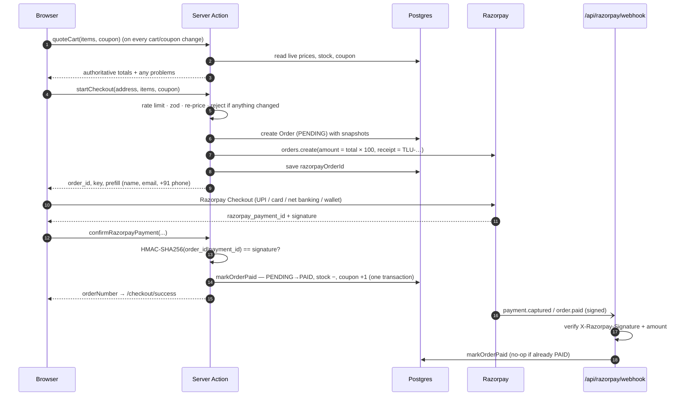

# Payments (Razorpay)

## Flow

## Guarantees

| Guarantee | How |
|---|---|
| Customer can't change the price | `startCheckout` ignores client prices; amount sent to Razorpay is computed server-side from the DB. |
| A payment is only accepted for its own order | Signature covers `order_id|payment_id`; the order is looked up by `id` **and** `userId` **and** `razorpayOrderId`. |
| Paid exactly once | `markOrderPaid` claims `status = PENDING` with a conditional update inside a transaction; the webhook and the client can race safely. |
| Stock and coupon usage stay consistent | Decremented/incremented in the same transaction as the status change. |
| Closed tab ≠ lost order | Webhook marks the order paid even if the browser never returns. |
| Forged webhooks rejected | HMAC over the raw body with `RAZORPAY_WEBHOOK_SECRET`, constant-time compare → `401`. |
| Under/over-payment detected | Webhook compares `payment.amount` with `toPaise(order.total)`; mismatches are logged and **not** marked paid. |

## Modes

| Mode | When | Behaviour |
|---|---|---|
| **Live** | `rzp_live_…` keys | Real money. |
| **Test** | `rzp_test_…` keys | Razorpay's test environment ("Test Mode" ribbon); use test cards / Netbanking → *Success*. |
| **Local test-payment** | no keys **and** `NODE_ENV !== "production"` | No Razorpay at all; "Place test order" marks the order paid. Used by CI. |
| **Disabled** | no keys in production | The server refuses to start (env validation), so this never reaches customers. |

## Testing payments by hand

1. Use test keys in `.env`, restart `npm run dev`.
2. Add something to the cart, check out, use a **realistic mobile number** (Razorpay rejects
   `9876543210` and re-asks for the number).
3. In Razorpay Checkout choose **Netbanking → any bank → Success** (or a
   [test card](https://razorpay.com/docs/payments/payments/test-card-details/), OTP page → Success).
4. You should land on `/checkout/success`, get the confirmation email (or see it in `.dev-outbox/`),
   and see the order as **Confirmed** in `/admin/orders`.

To test the webhook locally, expose the dev server (e.g. `ngrok http 3000`) and add a test-mode
webhook in the Razorpay dashboard pointing at `https://<tunnel>/api/razorpay/webhook`.

## Going live

1. Complete Razorpay KYC (they review the policy, contact and product pages).
2. Generate **live** keys; set `NEXT_PUBLIC_RAZORPAY_KEY_ID` and `RAZORPAY_KEY_SECRET` in Vercel
   *Production* only (keep test keys in *Preview*).
3. Create a **live-mode** webhook (`payment.captured`, `order.paid`) and set its secret.
4. Redeploy, buy a ₹1–₹10 item with a real card/UPI, confirm it appears as paid, then refund it from
   the Razorpay dashboard and mark it `REFUNDED` in the admin.

## Known gaps

- **Two buyers, last unit:** stock is checked when the order is created and decremented when it's
  paid. If two people pay for the last unit within seconds, stock goes to −1; the admin low-stock list
  shows it as "Out". Reservation at checkout is on the roadmap.
- **COD** is not supported yet (see roadmap — recommended for India).
- Refunds are done in the Razorpay dashboard, not from the admin.
