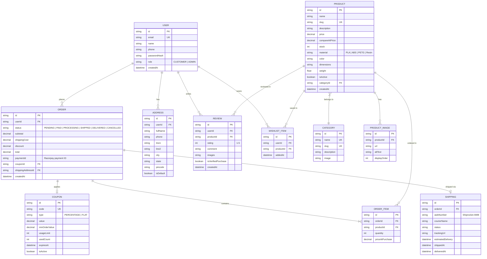
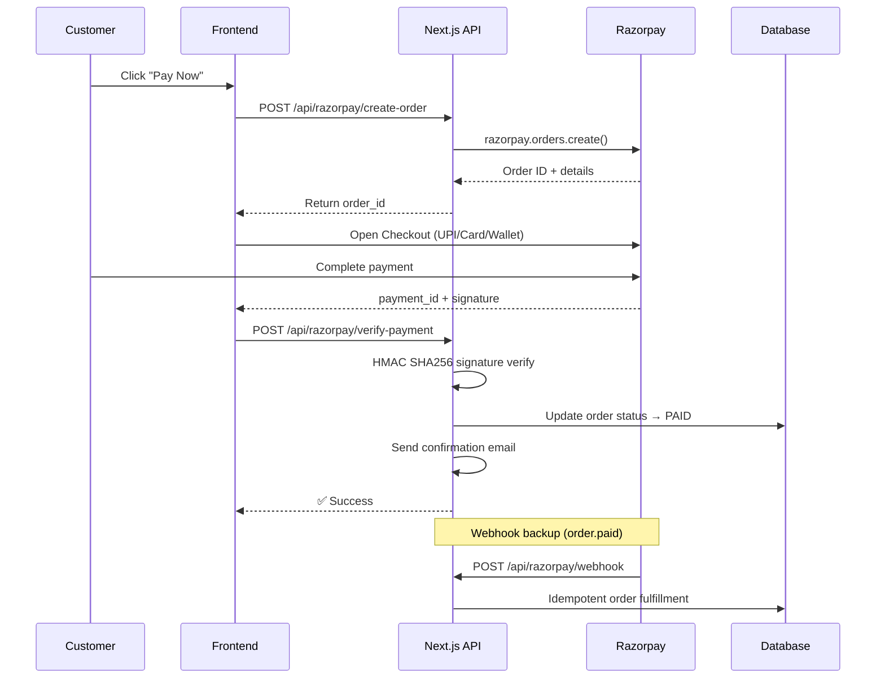
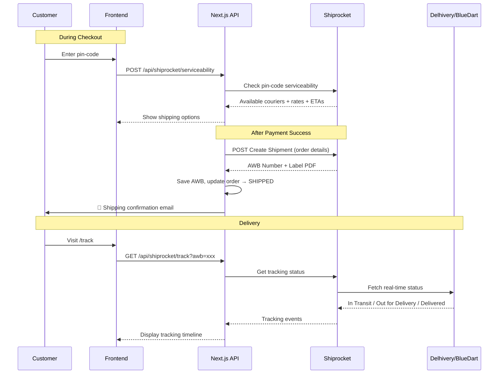
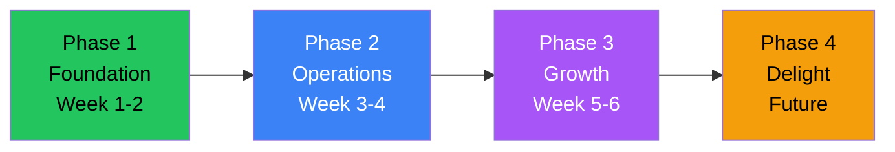

# 🚀 3D Print Business — E-Commerce Website Plan

## 📌 Project Overview

Build a full-stack, production-ready e-commerce website for your 3D printing business — inspired by **simplethingss.in** (D2C aesthetic product store) and **3dkavi.com** (custom 3D printing + personalized products). The site should feel **young, professional, and foundational** — ready to scale.

---

> **Status, changes to this plan and improvement ideas now live in [roadmap.md](roadmap.md).** This file is the original product plan, kept for reference; where it differs from the code (e.g. Next.js 15 → 16, the schema), the code and the other docs are authoritative.

---

## 🎨 Design & Brand Direction

| Attribute | Direction |
|---|---|
| **Vibe** | Young + Professional — clean, bold, tech-forward |
| **Color Palette** | Dark base (charcoal/deep navy) + vibrant accent (electric blue, neon green, or cyber orange) + crisp white |
| **Typography** | Modern geometric sans-serif (Inter / Space Grotesk / Plus Jakarta Sans) |
| **Layout** | Bento grid cards for products, full-bleed hero sections, micro-animations on scroll |
| **Inspiration** | Apple product pages meets streetwear e-commerce — minimal but impactful |

### Design Highlights
- **Hero Section** — Full-width video/animation of 3D printer in action + bold tagline
- **Product Cards** — Hover-to-rotate product preview, quick-add-to-cart
- **Dark Mode Default** — Makes 3D printed product photos pop; light mode toggle available
- **Mobile-First** — 70%+ of Indian D2C traffic is mobile

---

## 🏗️ Tech Stack

| Layer | Technology | Why |
|---|---|---|
| **Framework** | **Next.js 16** (App Router, Cache Components) | SSR + SSG for SEO, Server Actions, API Routes |
| **Language** | **TypeScript** | End-to-end type safety |
| **Styling** | **Tailwind CSS 4** + **shadcn/ui** | Rapid, utility-first styling + accessible components |
| **Database** | **PostgreSQL** (via Neon / Supabase) | Relational integrity for orders, products, users |
| **ORM** | **Prisma 6** (→ 7 after Node upgrade) | Type-safe DB queries, auto-generated types, migrations |
| **Auth** | **NextAuth.js (Auth.js)** | Google/Email sign-in, session management |
| **Payments** | **Razorpay** | UPI, Cards, Wallets, Net Banking — all India payment modes |
| **Shipping** | **Shiprocket API** | Aggregated shipping (Delhivery, Blue Dart, DTDC etc.) |
| **File Storage** | **Cloudinary** or **Uploadthing** | Product images + STL file uploads |
| **State Mgmt** | **Zustand** | Lightweight cart & UI state |
| **Validation** | **Zod** + React Hook Form | Type-safe forms (checkout, custom order) |
| **Email** | **Resend** + **React Email** | Transactional emails (order confirmation, shipping updates) |
| **Deployment** | **Vercel** | Zero-config Next.js deployment, edge caching, analytics |

---

## 📁 Project Structure

```
epic-darwin/
├── app/                          # Next.js App Router
│   ├── (storefront)/             # Customer-facing pages
│   │   ├── page.tsx              # Homepage
│   │   ├── products/
│   │   │   ├── page.tsx          # Product catalog (grid + filters)
│   │   │   └── [slug]/
│   │   │       └── page.tsx      # Product detail page
│   │   ├── cart/
│   │   │   └── page.tsx          # Shopping cart
│   │   ├── checkout/
│   │   │   └── page.tsx          # Checkout + Razorpay
│   │   ├── custom-order/
│   │   │   └── page.tsx          # Custom 3D print request form
│   │   ├── track/
│   │   │   └── page.tsx          # Order tracking
│   │   ├── about/
│   │   │   └── page.tsx          # About us / Our Story
│   │   ├── contact/
│   │   │   └── page.tsx          # Contact page
│   │   └── layout.tsx            # Storefront layout (navbar + footer)
│   │
│   ├── (auth)/                   # Auth pages
│   │   ├── login/page.tsx
│   │   ├── register/page.tsx
│   │   └── layout.tsx
│   │
│   ├── account/                  # User dashboard
│   │   ├── page.tsx              # Profile
│   │   ├── orders/page.tsx       # Order history
│   │   ├── addresses/page.tsx    # Saved addresses
│   │   └── wishlist/page.tsx     # Wishlist
│   │
│   ├── admin/                    # Admin dashboard
│   │   ├── page.tsx              # Dashboard overview (stats)
│   │   ├── products/             # CRUD products
│   │   ├── orders/               # Manage orders
│   │   ├── customers/            # Customer list
│   │   ├── shipping/             # Shipping management
│   │   ├── analytics/            # Sales analytics
│   │   └── layout.tsx            # Admin sidebar layout
│   │
│   ├── api/                      # API Routes
│   │   ├── auth/[...nextauth]/   # NextAuth
│   │   ├── razorpay/
│   │   │   ├── create-order/route.ts
│   │   │   ├── verify-payment/route.ts
│   │   │   └── webhook/route.ts
│   │   ├── shiprocket/
│   │   │   ├── create-shipment/route.ts
│   │   │   ├── track/route.ts
│   │   │   └── serviceability/route.ts
│   │   ├── products/route.ts
│   │   ├── orders/route.ts
│   │   ├── upload/route.ts       # STL/image upload
│   │   └── contact/route.ts
│   │
│   ├── layout.tsx                # Root layout
│   └── globals.css               # Global styles
│
├── components/
│   ├── ui/                       # shadcn/ui primitives
│   ├── storefront/               # Store components
│   │   ├── Navbar.tsx
│   │   ├── Footer.tsx
│   │   ├── HeroSection.tsx
│   │   ├── ProductCard.tsx
│   │   ├── ProductGrid.tsx
│   │   ├── CartDrawer.tsx
│   │   ├── CheckoutForm.tsx
│   │   ├── RazorpayButton.tsx
│   │   ├── CustomOrderForm.tsx
│   │   ├── ReviewCard.tsx
│   │   └── CategoryFilter.tsx
│   ├── admin/                    # Admin components
│   │   ├── Sidebar.tsx
│   │   ├── StatsCards.tsx
│   │   ├── OrderTable.tsx
│   │   ├── ProductForm.tsx
│   │   └── ShippingPanel.tsx
│   └── shared/                   # Shared components
│       ├── Logo.tsx
│       ├── ThemeToggle.tsx
│       ├── SearchBar.tsx
│       └── LoadingSpinner.tsx
│
├── lib/
│   ├── prisma.ts                 # Prisma client singleton
│   ├── razorpay.ts               # Razorpay SDK instance
│   ├── shiprocket.ts             # Shiprocket API helpers
│   ├── auth.ts                   # NextAuth config
│   ├── email.ts                  # Resend email helpers
│   ├── upload.ts                 # File upload helpers
│   ├── utils.ts                  # Utility functions
│   └── validators.ts             # Zod schemas
│
├── stores/
│   └── cart-store.ts             # Zustand cart store
│
├── prisma/
│   ├── schema.prisma             # Database schema
│   ├── seed.ts                   # Seed data
│   └── migrations/               # Prisma migrations
│
├── public/
│   ├── images/
│   ├── icons/
│   └── fonts/
│
├── emails/                       # React Email templates
│   ├── OrderConfirmation.tsx
│   ├── ShippingUpdate.tsx
│   └── WelcomeEmail.tsx
│
├── .env.local                    # Environment variables
├── next.config.ts
├── tailwind.config.ts
├── tsconfig.json
├── package.json
└── README.md
```

---

## 🔧 Feature Breakdown (by Phase)

### Phase 1 — Foundation (Week 1–2) ✅ Build First
> The minimum viable store — browse, cart, pay, and order.

| # | Feature | Details |
|---|---|---|
| 1 | **Project Setup** | Next.js + Tailwind + shadcn/ui + Prisma + PostgreSQL |
| 2 | **Database Schema** | Users, Products, Categories, Orders, OrderItems, Addresses, Reviews |
| 3 | **Homepage** | Hero section, featured products, categories, testimonials, CTA |
| 4 | **Product Catalog** | Grid view with search, filter by category/price/material, sort |
| 5 | **Product Detail Page** | Image gallery, description, specs (material, size, color), add to cart, reviews |
| 6 | **Shopping Cart** | Slide-over drawer, quantity controls, remove items, subtotal, proceed to checkout |
| 7 | **Authentication** | Google OAuth + email/password sign-up via NextAuth |
| 8 | **Checkout Flow** | Address form → order summary → Razorpay payment |
| 9 | **Razorpay Integration** | Create order → open checkout → verify payment signature → save order |
| 10 | **Order Confirmation** | Success page + confirmation email via Resend |
| 11 | **Responsive Design** | Mobile-first, works perfectly on all screen sizes |

### Phase 2 — Operations (Week 3–4) 📦
> Admin panel and shipping — the backend of running a business.

| # | Feature | Details |
|---|---|---|
| 12 | **Admin Dashboard** | Stats overview: total revenue, orders today, top products |
| 13 | **Product Management** | Add/edit/delete products, upload images, set variants (color/size) |
| 14 | **Order Management** | View all orders, update status (Processing → Shipped → Delivered), order detail view |
| 15 | **Shiprocket Integration** | Pin-code serviceability check, create shipment, generate AWB + label, track shipment |
| 16 | **Shipping on Checkout** | Show available couriers + rates based on pin-code at checkout |
| 17 | **Order Tracking Page** | Customer-facing real-time tracking via Shiprocket API |
| 18 | **Transactional Emails** | Order confirmed, shipped, out-for-delivery, delivered email notifications |
| 19 | **Inventory Management** | Stock count, low-stock alerts, auto-disable out-of-stock products |

### Phase 3 — Growth (Week 5–6) 🚀
> Features that drive repeat purchases and differentiate your brand.

| # | Feature | Details |
|---|---|---|
| 20 | **Custom 3D Print Request** | Upload STL/OBJ file or describe your idea + reference images. Get a quote. |
| 21 | **User Account Dashboard** | Order history, saved addresses, wishlist, profile settings |
| 22 | **Wishlist** | Save products for later, share wishlist |
| 23 | **Product Reviews & Ratings** | Verified-purchase reviews with star ratings + photo uploads |
| 24 | **Search (Full-Text)** | Fast product search with autocomplete |
| 25 | **Coupon & Discount System** | Percentage/flat discounts, minimum cart value, expiry dates |
| 26 | **Related Products** | "You may also like" recommendations on product pages |
| 27 | **About / Story Page** | Brand story, team, 3D printing process showcase |
| 28 | **Contact Page** | Contact form + WhatsApp chat link + social media links |
| 29 | **SEO Optimization** | Meta tags, Open Graph, structured data (JSON-LD), sitemap, robots.txt |
| 30 | **Analytics Dashboard** | Sales trends, revenue charts, top products, customer geography |

### Phase 4 — Delight (Future) ✨
> Premium features for when the business scales.

| # | Feature | Details |
|---|---|---|
| 31 | **3D Model Viewer** | Interactive Three.js viewer on product pages — rotate, zoom, inspect |
| 32 | **Instant STL Quote Calculator** | Upload file → auto-calculate volume → price by material |
| 33 | **Bulk / Corporate Orders** | Dedicated flow for bulk orders with custom pricing |
| 34 | **Blog / Resources** | 3D printing tips, guides, use cases (drives organic SEO traffic) |
| 35 | **Referral Program** | Share-and-earn discounts |
| 36 | **Push Notifications** | Order updates via web push |
| 37 | **PWA Support** | Installable on mobile as an app |
| 38 | **Multi-language (Hindi/English)** | i18n support for broader reach |
| 39 | **COD (Cash on Delivery)** | Via Shiprocket COD integration |
| 40 | **Return & Refund Management** | Automated return requests, reverse shipping |

---

## 🗄️ Database Schema Overview



---

## 💳 Payment Flow (Razorpay)



---

## 📦 Shipping Flow (Shiprocket)



---

## 📄 Key Pages Preview

### 🏠 Homepage Sections
1. **Hero Banner** — Video/animated background of 3D printer creating a product + tagline: *"Crafted Layer by Layer, Designed for You"*
2. **Featured Categories** — Bento grid: Lamps, Decor, Keychains, Custom Prints, Gifts
3. **Trending Products** — Horizontal scrollable product cards with quick-add
4. **How It Works** — 3-step visual: Browse → Order → Delivered to Your Door
5. **Custom Print CTA** — *"Got an idea? We'll print it."* + Upload/Request button
6. **Testimonials** — Customer reviews carousel with photos
7. **Instagram Feed** — Embedded social proof grid
8. **Newsletter** — Email signup for launches and drops

### 🛍️ Product Detail Page
- **Image Gallery** — Multi-image carousel with zoom
- **Product Info** — Name, price, ~~compare-at-price~~, material, dimensions, weight
- **Variant Selector** — Color/size pills
- **Add to Cart** + **Buy Now** buttons
- **Accordion** — Description, Specifications, Shipping Info, Reviews
- **Related Products** — "You May Also Like" grid

### 📊 Admin Dashboard
- **KPI Cards** — Revenue today, orders this week, avg order value, total customers
- **Recent Orders** — Table with status badges, quick actions
- **Revenue Chart** — Line/bar chart (daily/weekly/monthly)
- **Low Stock Alerts** — Products running low
- **Quick Actions** — Add product, process order, generate reports

---

## 🔐 Environment Variables Needed

```env
# Database
DATABASE_URL=postgresql://...

# NextAuth
NEXTAUTH_SECRET=your-secret
NEXTAUTH_URL=http://localhost:3000
GOOGLE_CLIENT_ID=...
GOOGLE_CLIENT_SECRET=...

# Razorpay
NEXT_PUBLIC_RAZORPAY_KEY_ID=rzp_test_xxx
RAZORPAY_KEY_SECRET=...

# Shiprocket
SHIPROCKET_EMAIL=...
SHIPROCKET_PASSWORD=...

# Cloudinary / Uploadthing
CLOUDINARY_CLOUD_NAME=...
CLOUDINARY_API_KEY=...
CLOUDINARY_API_SECRET=...

# Email (Resend)
RESEND_API_KEY=...

# App
NEXT_PUBLIC_APP_URL=http://localhost:3000
```

---

## 🎯 Implementation Priority



> [!IMPORTANT]
> **Phase 1 is the MVP.** Once that's live and taking orders, Phases 2–4 are iterative improvements. We build foundationally so every phase plugs in cleanly.

---

## ✅ Ready to Build?

Once you approve this plan (or want changes), I'll start with **Phase 1** — setting up the project, database schema, and building the storefront page by page. We'll have a working store with cart + Razorpay payments by the end of Phase 1.

**Questions for you before we start** (current assumptions in *italics*, so change any that are wrong):

1. **Business Name / Brand Name** — *TheLayerUp* (from the logo + CSS). Change it in `src/config/site.ts` and `Logo.tsx`.
2. **Domain** — ✅ https://thelayerup.in
3. **Primary Accent Color** — *#fe5a35 on cream #f5ece5.*
4. **Product Categories** — *Lamps, Planters & Vases, Desk & Tech, Keychains, Wall Art, Gifts* (seed data, editable).
5. **Database Hosting** — *recommended: Neon* (Mumbai region), see README → Deploying.
6. **Contact details** — ✅ WhatsApp/phone +91 63832 71769, Chennai. Confirm the email address `hello@thelayerup.in` exists.
